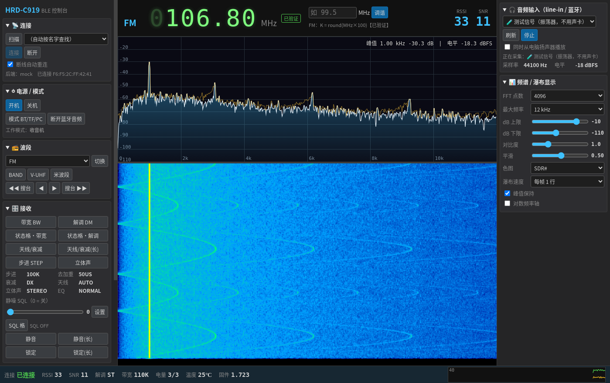

<div align="center">

# 📻 C919 Console

**汉荣达 HRD-C919 / Raddy RF919 收音机的电脑控制台：BLE 遥控 + 音频频谱/瀑布图，界面仿 SDR#**


-blue?logo=linux)




</div>

> [!NOTE]
> 本项目与汉荣达、Raddy 及官方 App 开发商无任何关联。协议来自对官方 Android App 的逆向分析和真机抓包，**仅供学习和个人使用**。

## ✨ 功能

- **BLE 遥控**：开关机、波段、直接输入频率、滚轮逐位调谐、音量、静噪、带宽、解调、天线/衰减、存台/调台、睡眠、时间同步、闹钟……按 RF919 说明书逐项对照实现，另有包含全部 70 多个键码的"全部按键"面板。
- **实时状态**：频率、工作模式、RSSI / SNR（含历史曲线）、解调、带宽、电量、温度、固件版本。
- **音频频谱 + 瀑布图**：采集收音机 AUX 输出的声音做 FFT，约 30fps，FFT 点数、dB 范围、对比度、色图可调。
  > 这是**当前频率的音频频谱**，不是射频全景——C919 没有 IQ 输出。
- **无需配对、无需心跳**：连上即用，断线自动重连。
- **原始帧日志**：所有收发帧写入 `c919_rx.log`，`tail -f` 即可边用边看。
- **模拟模式**：没有收音机也能跑完整界面（`npm run mock`）。

## 🚀 快速开始

```bash
# 依赖（Fedora 示例；Debian/Ubuntu 见 docs/DETAILS.md）
sudo dnf install nodejs gcc-c++ make python3 systemd-devel bluez-libs-devel

git clone <this-repo> && cd c919-electron
npm install        # 国内网络：先 export ELECTRON_MIRROR=https://npmmirror.com/mirrors/electron/
npm start          # 点「连接」，自动查找 HRD-C919-BLE
```

| 命令 | 用途 |
|---|---|
| `npm start` | 连接真机（默认 BlueZ D-Bus 后端，无需 root） |
| `npm run mock` | 模拟收音机 |
| `npm test` | 协议单元测试 + 模拟集成测试 |
| `C919_BLE_BACKEND=noble npm start` | 备用 noble 后端（需要 `cap_net_raw`，会和 bluetoothd 抢适配器） |

## 🔊 音频怎么接

| 方式 | 说明 |
|---|---|
| **USB 声卡（推荐）** | 收音机 AUX → 声卡 mic/line-in，二三十块的免驱声卡即可。收音机音量调小，防止削顶。 |
| 独立 line-in / mic 插孔 | 直接插。 |
| ⚠️ 笔记本耳麦二合一插孔 | **不行**：三段插头插进四段插孔会被识别为耳机，麦克风通道不会打开。需要 CTIA 一分二转接线。 |
| 蓝牙 A2DP 发射器 | 理论可行（电脑当 A2DP Sink），但延迟 150–300ms、SBC 有损压缩会影响频谱细节，且依赖 PipeWire/WirePlumber 配置，见 [docs/DETAILS.md](docs/DETAILS.md#7-音频输入line-in-和蓝牙-a2dp)。 |

## 📡 协议速览

| 项 | 值 |
|---|---|
| 设备名 | `HRD-C919-BLE` |
| 服务 / 写 / 通知 | `ff12` / `ff13`（write with response）/ `ff14` |
| 帧格式 | `AB LEN CMD payload SUM`，SUM = 前面所有字节和的低 8 位 |
| 握手 | `AB 01 FF AB` |
| 按键 | `AB 02 0C <key> SUM`，例：开机 `AB 02 0C 14 CD` |
| 设频率 | `AB 06 10 <band> <K: 4 字节小端>`，FM 下 K 单位 10kHz |
| RSSI / SNR | `0x1C` GBK 文字帧，fid 8 / fid 6，约 1 次/秒 |

完整协议（含出处行号、上行帧解析、已验证/推断标注）：[docs/PROTOCOL.md](docs/PROTOCOL.md)
说明书功能覆盖表、架构、权限、已知限制：[docs/DETAILS.md](docs/DETAILS.md)

## ✅ 验证状态

真机（HRD-C919，固件 1.723）验证过：连接与握手、状态解析、RSSI/SNR、开机、FM 直接设频。
其余按键效果、FM 以外波段的频率换算、静噪/睡眠/时间/闹钟指令来自 App 反编译，**尚待真机确认**——欢迎带着 `c919_rx.log` 提 issue / PR。

蓝牙控制做不到的（只能机身操作）：接收设置菜单（LNA/HPF/LPF/GAIN）、系统设置、DISPLAY/TIME/ALARM 键、实体锁定开关。

## 🗂️ 结构

```
src/protocol.js   拼帧 / 切帧 / 解析 / 键码表（纯函数，可单测）
src/ble.js        BlueZ / noble / mock 三种后端，重试与自动重连
src/main.js       Electron 主进程：BLE → 解析 → 日志 → IPC
src/renderer/     SDR# 风格界面、Web Audio 频谱与瀑布
test/             用真机抓到的帧做测试向量
```

## 📄 License

[MIT](LICENSE)

---

<div align="center">

**🤖 Built with Grok — 从 jadx 反编译的第一行，到 SDR# 风格界面的最后一像素。**

<sub>协议逆向、代码与文档由 Grok AI 协作完成；真机测试与需求把关：作者本人。</sub>

</div>
